# IAM-217: Access Review Training Project

**Michael Freeman | GRC analyst interview portfolio | TRAINING PROJECT**

I practiced an access review after a fictional employee changed teams. I used my own AWS Identity and Access Management (IAM) training account for the hands-on group example. The APHS Production ticket, approvals, Identity Center records, Vanta-style task, and GovRAMP follow-up are **simulated**. These are not Infotech records, and I did not perform a production change.

APHS means AASHTOWare Project Hosting Services in this exercise. The fictional user is Maya Patel (`mpatel.ops`). Her group is `APHS-Lab-CloudOps` throughout the case.

[Download the project walkthrough (PowerPoint)](IAM-217_Access_Review_Training_Project.pptx)

## 1. I read the ticket and checked the approved need

IAM-217 asked whether Maya's APHS Production access still fit her job after she moved from Cloud Operations to Customer Support. The ticket assigned me to review the records. It did not authorize me to make a production access change.

### Incoming ticket

**SIMULATED PRODUCTION EVIDENCE** · `IAM-217_00_Incoming_Ticket_Card.png`

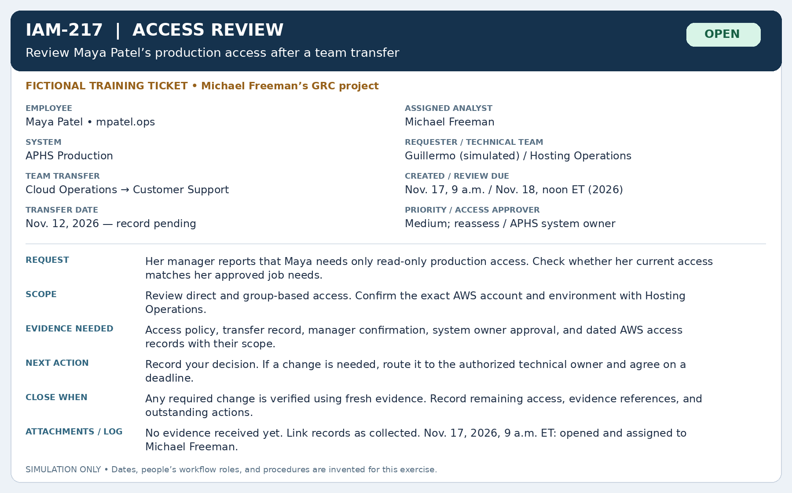

*This fictional ticket states the person, system, request, analyst, status, review due date, and evidence needed.*

### Manager's request and transfer record

**SIMULATED PRODUCTION EVIDENCE** · `IAM-217_01_Evidence_Request_and_Manager_Response.png`

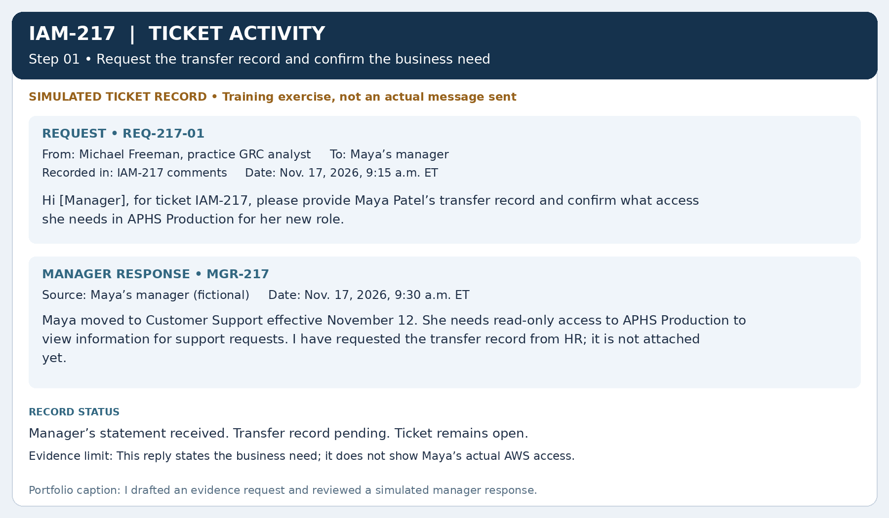

*I requested the transfer record and confirmed that Maya's manager said she needed read-only access for Customer Support.*

**SIMULATED PRODUCTION EVIDENCE** · `IAM-217_03_TR-217_Simulated_Transfer_Record.png`

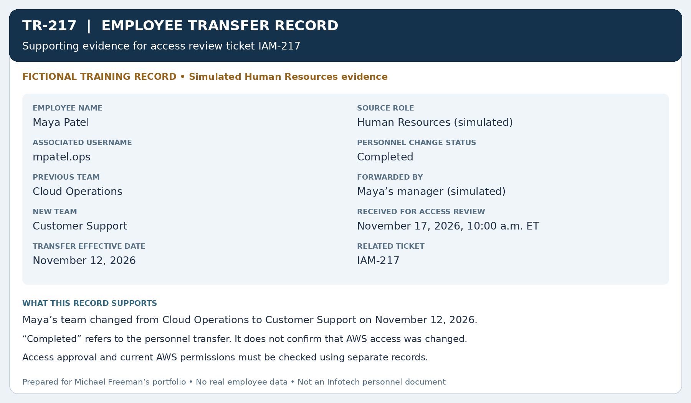

*TR-217 says Maya moved teams effective November 12, 2026. It does not prove her AWS access changed.*

### Policy and access approval

**SIMULATED PRODUCTION EVIDENCE** · `IAM-217_04_Policy_Request_and_Guillermo_Response.png`

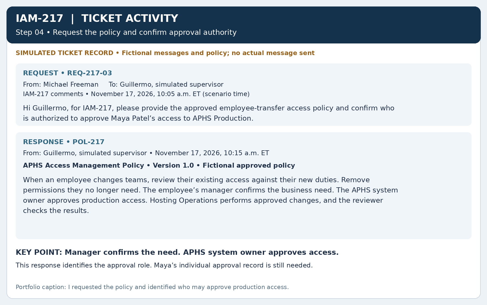

*I checked the fictional transfer rule: the manager confirms the need, the APHS system owner approves access, and Hosting Operations makes the approved technical change.*

**SIMULATED PRODUCTION EVIDENCE** · `IAM-217_05_Approval_Request_and_Response.png`

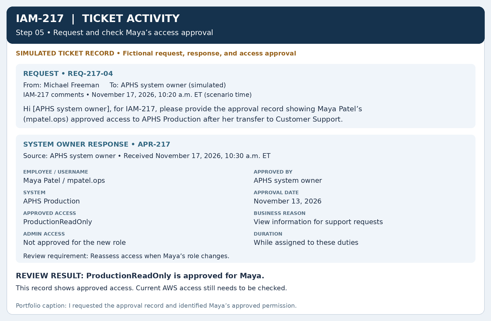

*APR-217 approves `ProductionReadOnly` for Maya in APHS Production. Admin access was not approved for her new role.*

## 2. I checked the access she actually had

I requested both **direct access** (assigned to Maya herself) and **group-based access** (assigned through a group she belonged to). I also asked which account, time, and type of assignment each record covered.

### The first export covered direct access only

**SIMULATED PRODUCTION EVIDENCE** · `IAM-217_06_AWS_Request_and_Direct_Access_Evidence.png`

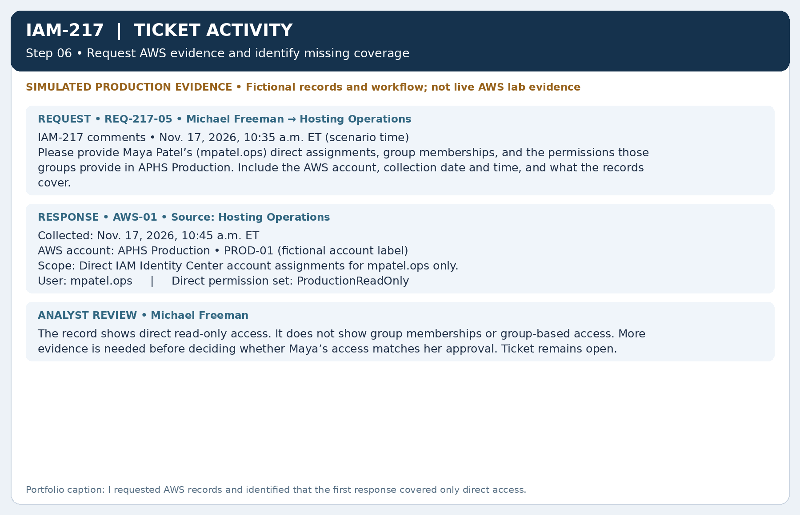

*AWS-01 shows a direct `ProductionReadOnly` assignment. It does not show whether Maya also had access through a group.*

### I requested the missing group records

**SIMULATED PRODUCTION EVIDENCE** · `IAM-217_07_Group_Evidence_and_Access_Trace.png`

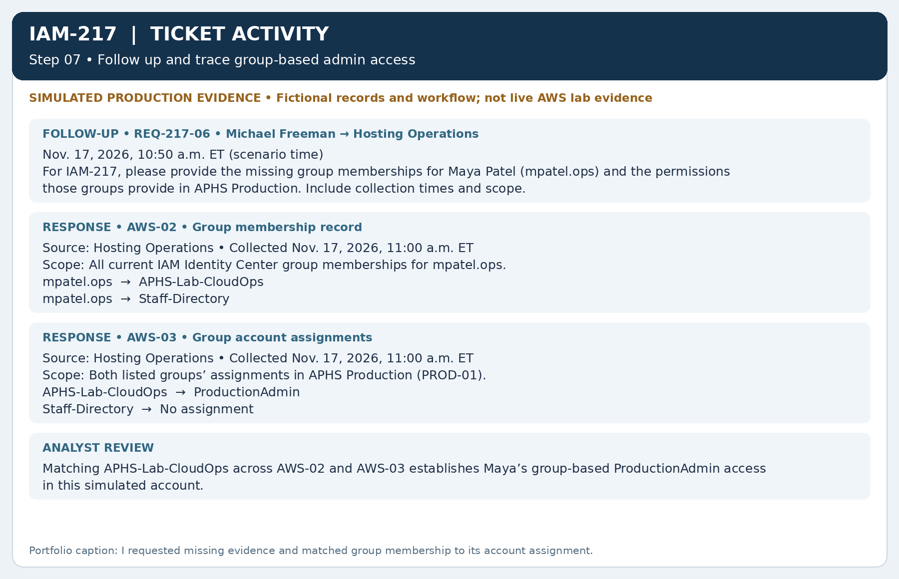

*AWS-02 lists `mpatel.ops` in `APHS-Lab-CloudOps`. AWS-03 assigns that same group `ProductionAdmin` in APHS Production. Together they show the simulated admin path. AWS-03 also shows `Staff-Directory` had no assignment there.*

My decision: keep the approved direct `ProductionReadOnly` assignment and remove Maya from the group that granted `ProductionAdmin`. The risk was that Maya could keep powerful production access after changing jobs, affecting APHS Production and the people who rely on it.

### I documented the finding and asked the technical owner to act

**SIMULATED PRODUCTION EVIDENCE** · `IAM-217_08_Finding_and_Remediation_Request.png`

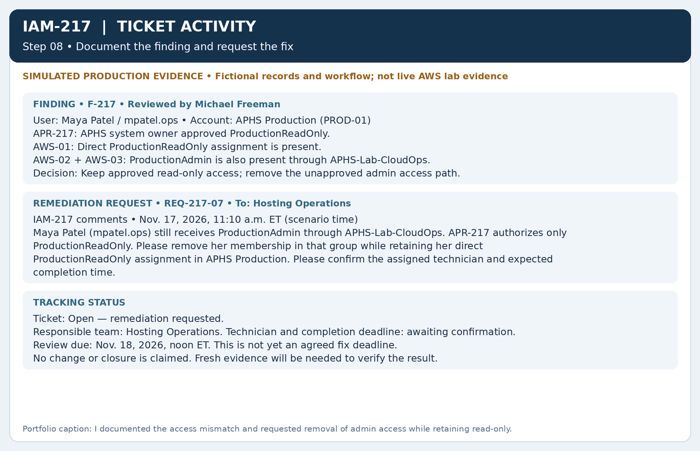

*F-217 records the mismatch. My request asks Hosting Operations to remove Maya's group membership while keeping read-only access. The technician and fix deadline were still awaiting confirmation in this image.*

I reviewed, documented, and tracked the finding. Hosting Operations was the fictional authorized team for the production change.

## 3. I practiced the group change in my live AWS lab

**LIVE AWS TRAINING ACCOUNT.** These images show a separate IAM lab. They do **not** show `ProductionAdmin`, `ProductionReadOnly`, the fictional APHS Production account, or an Infotech system. I created `mpatel.ops` with console sign-in disabled and did not create access keys. The screenshots below focus on the group and policy views. The AWS account number and full Amazon Resource Name (ARN) are hidden in the portfolio copies.

### Before the practice policy: membership and user baseline

**LIVE AWS TRAINING ACCOUNT** · `IAM-217_01_Before_Group_Membership.png`

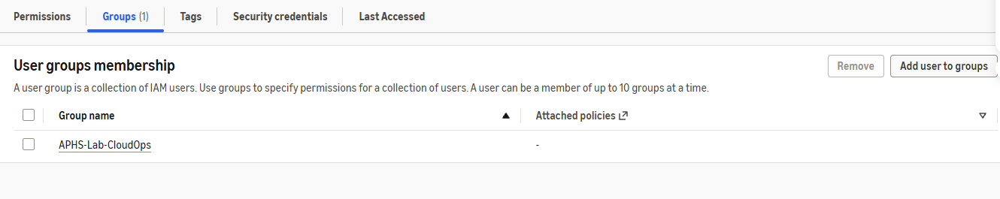

*The user Groups tab shows `mpatel.ops` belonged to `APHS-Lab-CloudOps` before the change.*

**LIVE AWS TRAINING ACCOUNT** · `IAM-217_02_User_Permissions_Baseline.png`

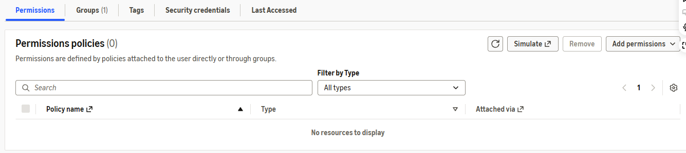

*The user Permissions tab showed zero listed permission policies before I attached the practice policy. This is a user baseline, not a screenshot of the group's Permissions tab.*

### I created one narrow practice policy

**LIVE AWS TRAINING ACCOUNT** · `IAM-217_09_Live_AWS_Practice_Policy_JSON.png`

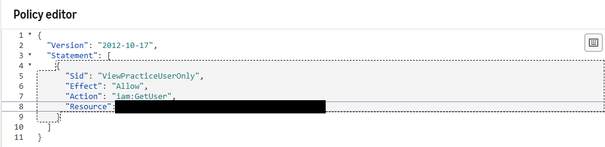

*The policy editor shows `iam:GetUser`, an action for viewing IAM user details. I hid the full resource ARN because it contains my account number; the policy review below shows the resource is the practice user.*

**LIVE AWS TRAINING ACCOUNT** · `IAM-217_10_Live_AWS_Policy_Review.png`

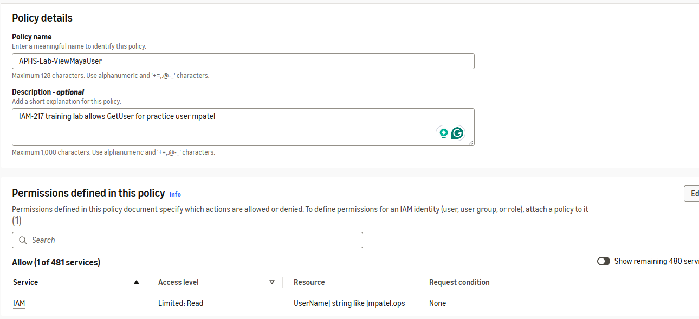

*The review names `APHS-Lab-ViewMayaUser` and shows limited read access to `mpatel.ops`. This is not a production administrator permission.*

### I attached it to the group and checked inheritance

**LIVE AWS TRAINING ACCOUNT** · `IAM-217_11_Live_AWS_Group_Policy_Attached.png`

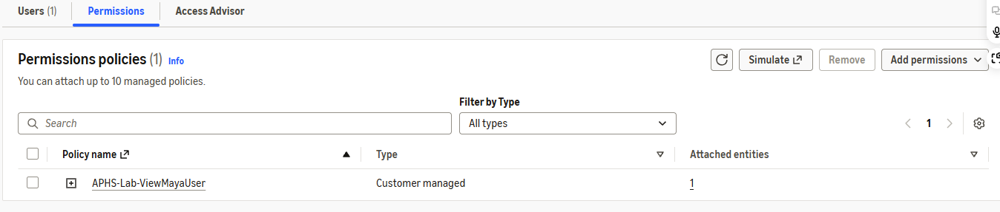

*The group Permissions tab lists `APHS-Lab-ViewMayaUser` as an attached policy.*

**LIVE AWS TRAINING ACCOUNT** · `IAM-217_12_Live_AWS_Inherited_Permission_Before.png`

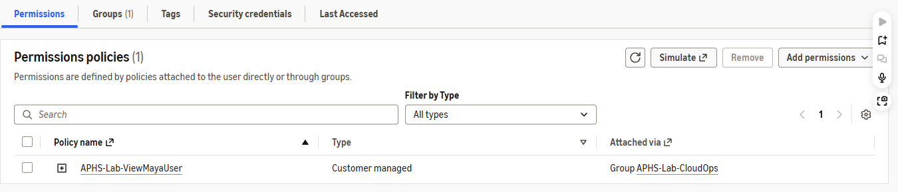

*The user Permissions tab lists the practice policy as attached via **Group APHS-Lab-CloudOps**. This is my actual lab “before” view.*

### I removed only Maya's lab group membership and checked again

**LIVE AWS TRAINING ACCOUNT** · `IAM-217_13_Live_AWS_Group_Membership_After.png`

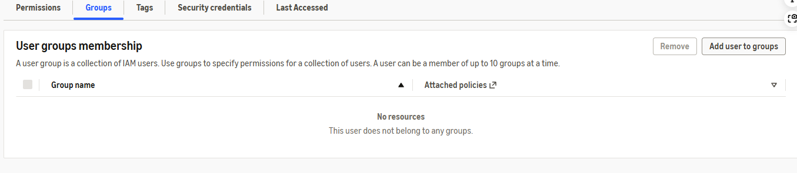

*The user Groups tab shows no group memberships after I removed `mpatel.ops` from `APHS-Lab-CloudOps`.*

**LIVE AWS TRAINING ACCOUNT** · `IAM-217_14_Live_AWS_Inherited_Permission_After.png`

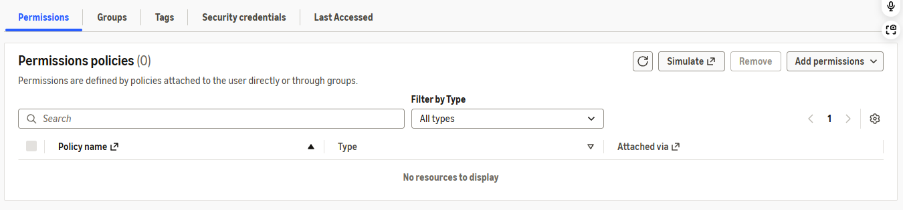

*The user Permissions tab shows zero listed policies afterward. The practice group policy no longer appears on this user; I did not delete the group's policy.*

These screenshots show the listed IAM policy and group state at the time I checked. They are not a production sign-in test or proof about other access systems.

## 4. I verified the fictional production fix with later records

### The change record told me what the technician reported

**SIMULATED PRODUCTION EVIDENCE** · `IAM-217_18_Completed_Change_Record.png`

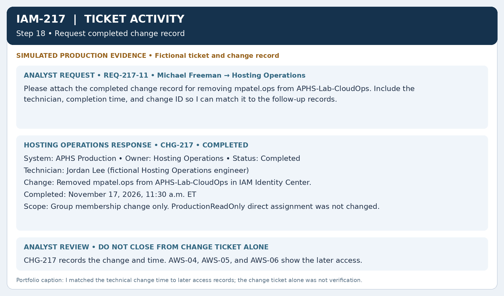

*CHG-217 says Hosting Operations removed Maya from the group at 11:30 a.m. ET on November 17. A completed change ticket alone does not show her later access.*

### I checked fresh group and direct records

**SIMULATED PRODUCTION EVIDENCE** · `IAM-217_15_Followup_Group_Evidence.png`

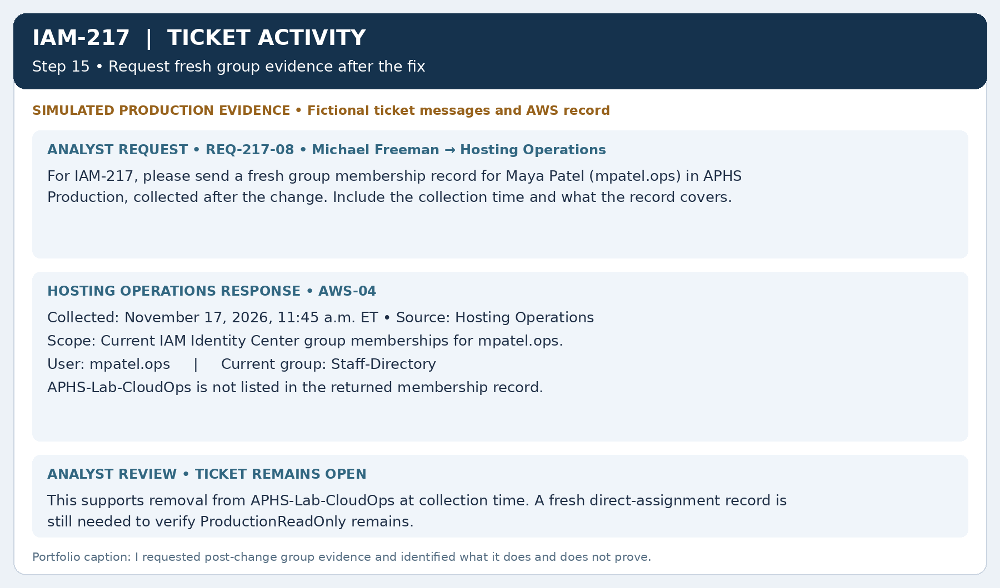

*AWS-04, collected at 11:45 a.m., no longer lists `APHS-Lab-CloudOps` for Maya. It lists `Staff-Directory`.*

**SIMULATED PRODUCTION EVIDENCE** · `IAM-217_16_Followup_Direct_Access.png`

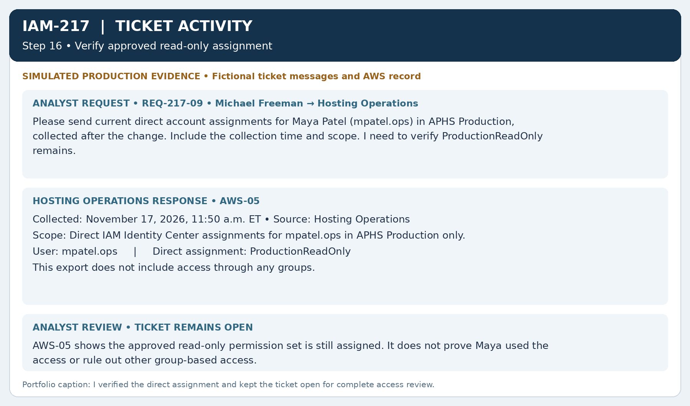

*AWS-05, collected at 11:50 a.m., still lists the approved direct `ProductionReadOnly` assignment. It does not cover group access.*

**SIMULATED PRODUCTION EVIDENCE** · `IAM-217_17_Remaining_Group_Assignment.png`

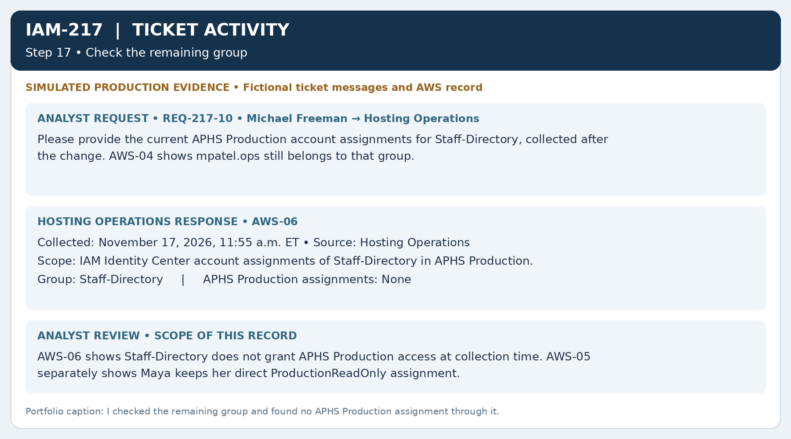

*AWS-06, collected at 11:55 a.m., shows `Staff-Directory` had no APHS Production account assignment.*

All three records were collected **after** CHG-217. Within the reviewed IAM Identity Center direct and group assignments for the fictional APHS Production account, they support removing the admin group path and keeping approved read-only access. They do not show that Maya signed in or used the permission.

### I recorded the limited closure decision

**SIMULATED PRODUCTION EVIDENCE** · `IAM-217_19_Simulated_Ticket_Closure.png`

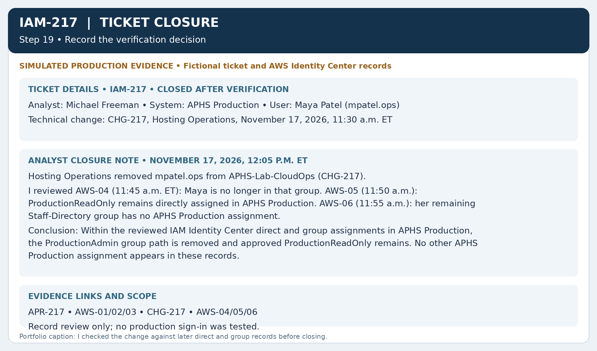

*The fictional closure note names the change, later records, remaining access, and the limit of the record review. IAM-217 is closed in the exercise.*

## 5. I prepared the simulated Vanta evidence task

Vanta can help a team gather and review evidence that a security control happened. This is a **mock Vanta-style screen**, not a live Vanta workspace. The task asked for a privileged access review covering **November 1–17, 2026**. One user's ticket could not prove that the whole review happened.

### I read the task and its requested evidence

**SIMULATED PRODUCTION EVIDENCE** · `IAM-217_20_Mock_Vanta_Evidence_Task_CORRECTED.png`

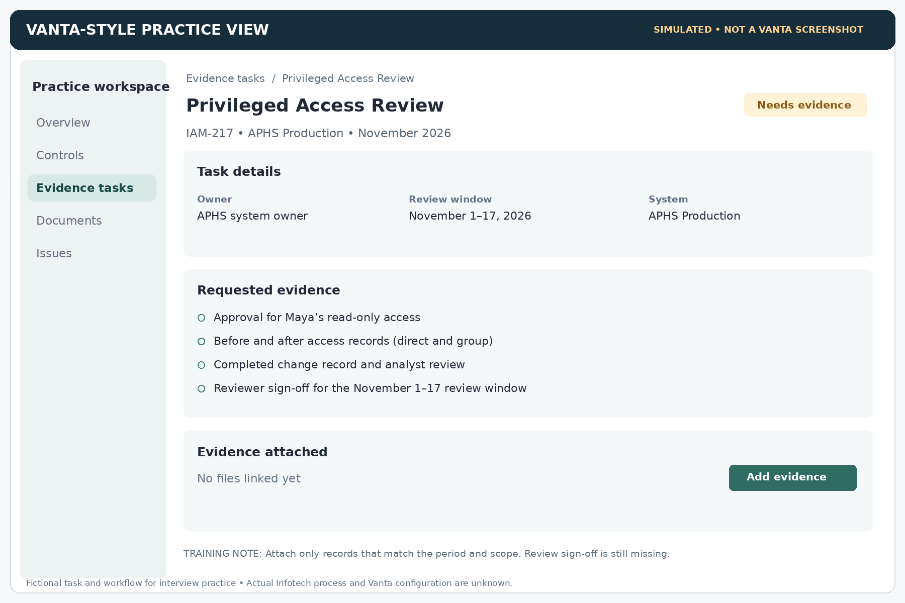

*The corrected mock task names APHS Production, the November 1–17 window, the owner, and the requested records. It initially needed evidence.*

### I checked the whole review's population and sign-off

**SIMULATED PRODUCTION EVIDENCE** · `IAM-217_22_Simulated_Review_Population.png`

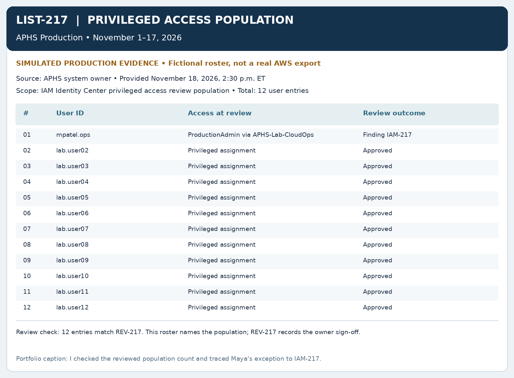

*LIST-217 lists 12 users in the fictional privileged access review population and links Maya's finding to IAM-217.*

**SIMULATED PRODUCTION EVIDENCE** · `IAM-217_21_Simulated_November_Review_Signoff.png`

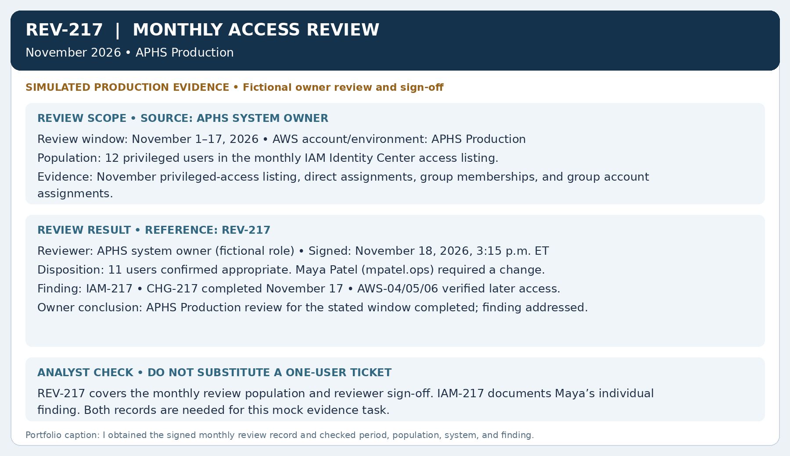

*REV-217 records the APHS system owner's sign-off for the November 1–17 review of 12 users. It is a separate record from Maya's ticket.*

### I linked records and submitted the mock task for owner review

**SIMULATED PRODUCTION EVIDENCE** · `IAM-217_23_Mock_Vanta_Submitted_For_Review.png`

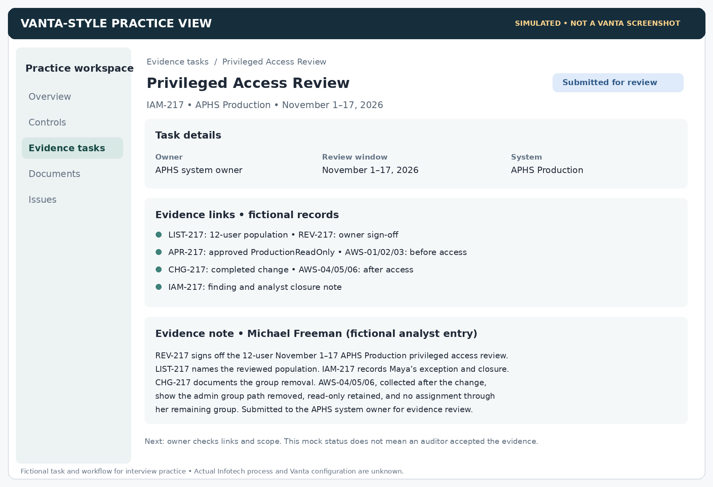

*The mock task links approval, before and after access, change, population, and sign-off records. Its status is **Submitted for review**; no auditor acceptance is claimed.*

## 6. I tracked a wider weakness in the simulated GovRAMP record

GovRAMP is a security program for cloud services used by state and local governments. A **Plan of Action and Milestones (POA&M)** records a weakness, the planned fix, an owner, a deadline, and the proof needed to close it. The fictional program owner confirmed this broader item belonged in the exercise POA&M. NIST AC-2 Account Management concerns how accounts and access are managed, including changes when a person's role changes.

**SIMULATED PRODUCTION EVIDENCE** · `IAM-217_24_Simulated_GovRAMP_POAM.png`

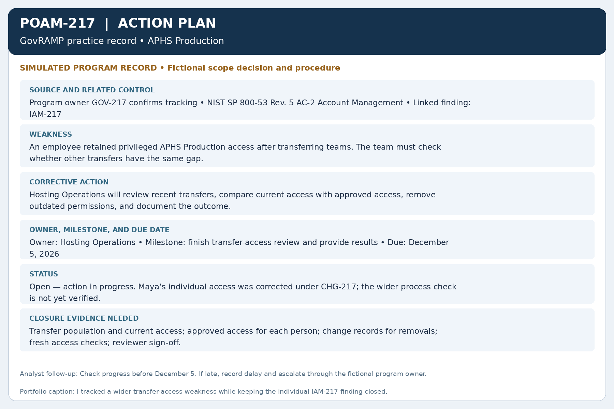

*POAM-217 assigns Hosting Operations a wider check of transferred employees, due December 5, 2026. It remains **open** because that wider check has not been verified, even though Maya's individual IAM-217 ticket is closed.*

## What I did myself and what I simulated

| Hands-on in my AWS training account | Simulated for the case |
| --- | --- |
| Created the practice IAM user and narrow `iam:GetUser` policy. | APHS Production access assignments and approval. |
| Added the user to the practice group and viewed the inherited policy. | Ticket messages, Hosting Operations change, and production verification. |
| Removed the user from the group and checked the group and policy views afterward. | Vanta-style task, monthly review records, and GovRAMP POA&M. |

## Three things I learned

1. I need both direct and group records to understand a person's access.
2. I need fresh access records collected after a change before I close the finding.
3. Closing one person's ticket does not prove the whole transfer process works for everyone.

**Note for the panel:** This is an interview practice scenario. I would ask Guillermo to confirm Infotech's real ticket system, approval rules, evidence standards, Vanta setup, and GovRAMP scope before doing this work on the team.
